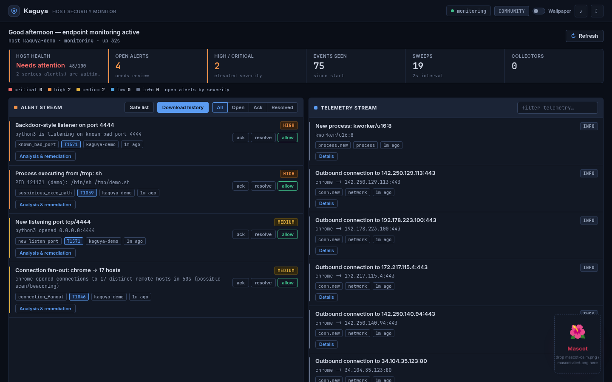
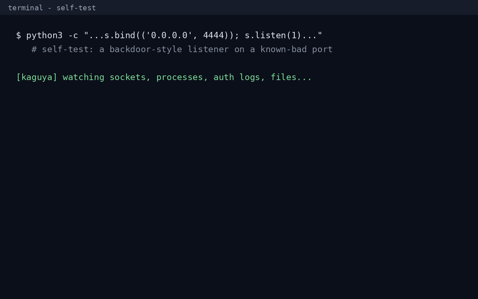

# 🌙 Kaguya

[](https://github.com/Ordixian/Kaguya/actions/workflows/ci.yml)
[](LICENSE)
[](https://www.python.org/)
[](https://github.com/Ordixian/Kaguya/releases)

**A lightweight host intrusion detection monitor: real telemetry, real detections, one command, no agents or database server.**



## Install in 3 lines

```bash
git clone https://github.com/Ordixian/Kaguya.git && cd Kaguya
pipx install -e ".[recommended]"      # or: pip install -r requirements.txt
kaguya run                            # then open http://127.0.0.1:8787
```

Needs Python 3.9+ on Linux, macOS or Windows. More options in [Install](#install-the-kaguya-command).

## Features

- **Live host telemetry**: sockets, processes, auth logs and file integrity. No mock data.
- **Detection engine**: SSH brute force, new listening ports, known-bad ports, connection fan-out, privilege events, suspicious exec paths, file-integrity changes.
- **MITRE ATT&CK tags** on alerts (e.g. `T1110` Brute Force).
- **Enterprise-style console**: dark and light themes, host-health matrix, severity strip, dense alert and telemetry streams.
- **Plain-English explanations** for every alert and event, with copy-ready fix commands.
- **Alert workflow**: grouping, ack / resolve / reopen, and a safe list you can undo.
- **Block IP** for SSH brute-force alerts (`ufw`/`iptables`, never a shell).
- **Reports** as PDF / Word / CSV, plus scheduled daily and weekly reports.
- **Notification sinks**: console, desktop, Slack, webhook, email.
- **Hardened API**: every write needs a custom header, a local Host and a same-origin check; no wildcard CORS.
- **Zero-dependency core** (Python standard library), with optional `psutil` and `PyYAML`.
- **Packaging**: `kaguya` command, Docker, systemd user service, CI, test suite.



*The [self-test](#try-it-safe-self-test): open port 4444 and a HIGH alert fires within one sweep.*

## Kaguya vs Wazuh / OSSEC

| | **Kaguya** | **Wazuh / OSSEC** |
|--|--|--|
| Setup | `pip install`, one process | Manager + agents (+ indexer and dashboard for Wazuh) |
| Dependencies | Python stdlib (core) | Dedicated server stack |
| Scale | Single host | Thousands of hosts |
| Rule library | 7 built-in rules | Large, mature rulesets and compliance packs |
| Storage | Local SQLite | Elasticsearch / OpenSearch |
| Best for | Personal machines, homelabs, learning, quick visibility | Production fleets, compliance, central SIEM |

Kaguya is not a replacement for a fleet-grade SIEM. It targets the case where standing one up is overkill.

## Documentation

- [Run Kaguya in the background (systemd)](docs/background-service.md)
- [API](docs/api.md)
- [Notifications and scheduled reports](docs/notifications.md)
- [Configuration, tiers and Docker](docs/configuration.md)
- [Contributing](CONTRIBUTING.md) · [Security policy](SECURITY.md) · [Changelog](CHANGELOG.md)

Questions or ideas? Open a [Discussion](https://github.com/Ordixian/Kaguya/discussions).

---

## Quick start guide (5 minutes)

**You need:** a Linux, macOS or Windows machine, **Python 3.9+**, and a web
browser. Nothing else: no database server, no cloud account.

1. **Get the code** and open a terminal in the folder:
   ```bash
   git clone https://github.com/Ordixian/Kaguya.git
   cd Kaguya
   ```

2. **Install** (pick one — details further down):
   ```bash
   pipx install -e ".[recommended]"      # Linux/macOS, recommended
   # or: python3 -m venv .venv && . .venv/bin/activate && pip install -e ".[recommended]"
   # or, with no install at all:  pip install -r requirements.txt
   ```
3. **Run it** from this folder (so it finds `config/config.yaml`):
   ```bash
   kaguya run                    # or: python3 -m cybersentinel run
   ```
4. **Open the dashboard:** <http://127.0.0.1:8787>
5. **Check it works** with the safe self-test in [Try it](#try-it-safe-self-test).
   Real alerts appear as Kaguya sees real activity on your machine.

**Optional extras**

| Want to… | Do this |
|----------|---------|
| Run in the background / at login | See [docs/background-service.md](docs/background-service.md) (a ready-made `deploy/kaguya.service`). |
| Get emailed daily/weekly PDF reports | See [docs/notifications.md](docs/notifications.md). Keep the SMTP password in the `CS_SMTP_PASSWORD` environment variable, never in the file. |
| Slack / webhook alerts | Fill `notify.slack.webhook_url` or set env `CS_SLACK_WEBHOOK` (`CS_WEBHOOK_URL` for generic webhooks). |
| Use Docker | `docker compose up -d` (see [docs/configuration.md](docs/configuration.md#docker)). |
| Wallpaper image/video | Save `wallpaper.jpg/.png/.webp` or `wallpaper.mp4/.webm` in `cybersentinel/web/`, then flip the **Wallpaper** switch (or press **W**). **Hold** an empty part of the page to peek at it. |
| Mascot | Save `mascot-calm.png` (and optionally `mascot-alert.png`, `mascot.gif`) in `cybersentinel/web/`. |
| Block attacker IPs | Needs root or passwordless sudo for `ufw`/`iptables`; otherwise the exact command is shown for you to run. |

**Troubleshooting**

- *Port 8787 already in use* → stop the other copy, or change `api.port` in `config/config.yaml`.
- *`externally-managed-environment` error* → use `pipx` or a virtualenv (above).
- *Page looks old* → hard-refresh with **Ctrl+Shift+R**.
- *Not seeing auth/SSH alerts* → reading system logs may need your user in the `adm`/`systemd-journal` group, or run with sudo.
- *Dashboard is local-only on purpose.* It binds to `127.0.0.1`; don't expose it to the internet.

---

## Why

Most host-monitoring stacks (ELK + Beats + Wazuh managers, etc.) are powerful
but heavy to stand up. Kaguya targets the other end: a single file-tree you can
run in one command, that still does the useful 20% — real detections on real
data — with a path to scale up.

---

## Install the `kaguya` command

Needs **Python 3.9+**. Installing the package puts a `kaguya` command on your
PATH so you can skip `python -m cybersentinel`. An **editable** install (`-e`)
is recommended — your edits to the code, config, and mascot images take effect
with no reinstall.

### 🐧 Linux

On Debian/Parrot/Ubuntu the system Python is "externally managed", so use
**pipx** (isolated, reversible with `pipx uninstall kaguya`):

```bash
pipx install -e ".[recommended]"      # run from the repo directory
```

<details>
<summary>Alternatives (venv, or no install)</summary>

```bash
# A virtualenv:
python3 -m venv .venv && . .venv/bin/activate
pip install -e ".[recommended]"

# …or no install at all — run the module directly:
pip install -r requirements.txt       # optional extras
python3 -m cybersentinel run
```
</details>

### 🪟 Windows

Use **PowerShell** with Python from [python.org](https://www.python.org/) or the
Microsoft Store:

```powershell
python -m pip install --user pipx ; python -m pipx ensurepath
pipx install -e ".[recommended]"      # run from the repo folder
```

<details>
<summary>Alternative (venv)</summary>

```powershell
python -m venv .venv ; .\.venv\Scripts\Activate.ps1
pip install -e ".[recommended]"
```
</details>

## Launch

Once installed, the `kaguya` command works from anywhere — but **run it from the
repo directory** so it picks up `config/config.yaml` (otherwise built-in
defaults are used; or pass `-c /path/to/config.yaml`).

```bash
kaguya sweep      # one-shot: baseline the host, wait, then print findings
kaguya run        # run the monitor + dashboard (the main mode)
kaguya status     # show config / tier / database status
```

The dashboard is at <http://127.0.0.1:8787>. `Ctrl-C` stops the monitor.
(No install? The same commands work as `python -m cybersentinel <cmd>`.)

> **Tip (Linux, full visibility):** auth-log/journald access and other users'
> process details need elevated rights. Add your user to the `adm` /
> `systemd-journal` group, or run with `sudo`. Without that, Kaguya still sees
> sockets, your own processes, and readable files.
>
> **Windows:** launch an elevated terminal ("Run as administrator") for complete
> process/socket ownership data. The `authlog` collector is Linux-only and stays
> idle there; network, process, and file-integrity collectors all work.

### Try it (safe self-test)

In another terminal, generate activity the engine will catch:

```bash
# a "backdoor-style" listener on a known-bad port
python3 -c "import socket,time; s=socket.socket(); \
  s.setsockopt(socket.SOL_SOCKET,socket.SO_REUSEADDR,1); \
  s.bind(('0.0.0.0',4444)); s.listen(1); time.sleep(120)"

# a process executing from /tmp  (Linux)
echo -e '#!/bin/sh\nsleep 120' > /tmp/demo.sh && chmod +x /tmp/demo.sh && /bin/sh /tmp/demo.sh
```

Within one sweep interval the dashboard shows **HIGH** alerts for the backdoor
listener and the `/tmp` execution — you'll hear the alert chime, a toast slides
in, and the mascot switches to its alert mood.

---

## The dashboard

The live dashboard at <http://127.0.0.1:8787> includes:

| Feature | How |
|---------|-----|
| **Light / Dark theme** | 🌗 button (top-right) or press **T**. Follows your OS theme until you pick; your choice is remembered. |
| **Alert chime + toast** | A soft bell and a slide-in card on every new HIGH/critical alert. |
| **Mute** | 🔊 button or press **M** (remembered across reloads). |
| **Greeting + Refresh** | A greeting bar with host + uptime, and a manual **Refresh** button. |
| **Mood mascot** | Calm when quiet, **alert** (red glow + shake) when a HIGH alert fires. **Click** it to enlarge and play `mascot.gif`; **double-click** (or Esc) to put it back. |
| **Plain-English explanations** | Every alert and event has a 💡 button: what it means, likely cause, how worried to be, and fix steps with copy-ready commands. |
| **Alert grouping** | Repeats of the same thing collapse into one card (`×40`) with ack/resolve-all and a member list. |
| **System health tile** | "All clear / Looking good / Mostly fine / Needs attention / Act now" with a 0-100 score (repeats count once). |
| **✓ Mark as safe** | Silences one specific kind of alert (a port, program path, IP, file…). Review or undo in **🛡 Safe list**. |
| **🚫 Block this IP** | On SSH brute-force alerts. Adds a firewall rule via `ufw`/`iptables` (needs root or passwordless sudo; otherwise shows the exact command to run). Refuses loopback; private/LAN addresses need extra confirmation. |
| **⬇ Download history** | Hourly → yearly (or custom dates) as PDF, Word (.docx) or CSV. CLI: `kaguya report --period week --format pdf`. |

### Adding your own mascot art

The mascot shows a styled placeholder until you drop in your own images. Save:

- `cybersentinel/web/mascot-calm.png` — the calm pose
- `cybersentinel/web/mascot-alert.png` — the alert pose *(optional; without it the calm image gets a red glow when alerts fire)*
- `cybersentinel/web/mascot.gif` — an animation, shown when you click it *(optional)*

Transparent PNGs look best. They load automatically — no restart needed, just
refresh the page.

---

## Architecture

```
          ┌──────────────┐   events   ┌──────────────────┐  alerts  ┌─────────┐
 host ──▶ │  Collectors  │ ─────────▶ │ Detection Engine │ ───────▶ │ SQLite  │
          │  (live data) │            │  (windowed rules)│          │ storage │
          └──────────────┘            └──────────────────┘          └────┬────┘
             network                      ssh brute-force                │
             process                      new listening port             │
             authlog                      suspicious exec path        ┌───▼────────────┐
             fim                          connection fan-out          │ HTTP API +     │
                                          known-bad port              │ live dashboard │
                                          file integrity              │ (stdlib only)  │
                                          privilege events            └────────────────┘
```

| Layer | What it does | Module |
|-------|--------------|--------|
| **Collectors** | Observe one aspect of the host each sweep and emit *diffs* (a port that *started* listening, a *new* process). | `cybersentinel/collectors/` |
| **Detection engine** | Runs rules over a rolling event window, de-duplicates with a cooldown. | `cybersentinel/detection/` |
| **Storage** | SQLite; indexes, retention, severity rollups. | `cybersentinel/storage.py` |
| **API + dashboard** | `http.server`-based JSON API and a zero-dependency web UI that polls it. | `cybersentinel/api/`, `cybersentinel/web/` |
| **Monitor** | Background orchestrator thread tying it together. | `cybersentinel/monitor.py` |

### Collectors (all live, no mock data)

- **network** — listening sockets and outbound connections via `psutil`
  (falls back to parsing `ss -tunap`). Emits `listen.new`, `listen.closed`,
  `conn.new`.
- **process** — new processes with exe path, cmdline, user, parent
  (`process.new`).
- **authlog** — SSH / sudo / PAM events from `/var/log/auth.log` or
  `/var/log/secure`; on systemd-only hosts it falls back to `journalctl`
  (`ssh.failed`, `ssh.accepted`, `ssh.invalid_user`, `auth.sudo`). *(Linux)*
- **fim** — SHA-256 file integrity monitoring of configured paths
  (`file.new`, `file.modified`, `file.deleted`).

### Detection rules

| Rule | Fires when | Severity |
|------|-----------|----------|
| `ssh_bruteforce` | ≥ N failed SSH logins from one IP within a window | HIGH |
| `new_listen_port` | a socket starts listening (MEDIUM if externally bound, LOW on loopback) | LOW/MED |
| `suspicious_exec_path` | a process runs from `/tmp`, `/dev/shm`, `/run/user`, `/var/tmp` | HIGH |
| `connection_fanout` | one process connects to many distinct hosts quickly (scan/beacon) | MEDIUM |
| `known_bad_port` | connection to — or a listener on — a known-bad port (4444, 1337, …) | MED/HIGH |
| `file_integrity` | a watched file is created / modified / deleted | MED/HIGH |
| `privilege_event` | `sudo` usage or a new root process | INFO/LOW |

All thresholds, ports, and watched paths are configurable in
`config/config.yaml`.

---

## Tests

```bash
python3 tests/test_detection.py      # no deps
# or
python3 -m pytest -q
```

---

## Built on open source

Python standard library (`http.server`, `sqlite3`, `hashlib`), `psutil`,
`PyYAML`, and standard tooling (`ss`, `journalctl`). Everything in this repo
is **MIT licensed**: see [`LICENSE`](LICENSE).

---

## Credits

Made by **Ordixian / Frost**. Kaguya was formerly called CyberSentinel; the
Python package is still named `cybersentinel` internally.

Questions or ideas: [GitHub Discussions](https://github.com/Ordixian/Kaguya/discussions) or <ordixian@proton.me>.
